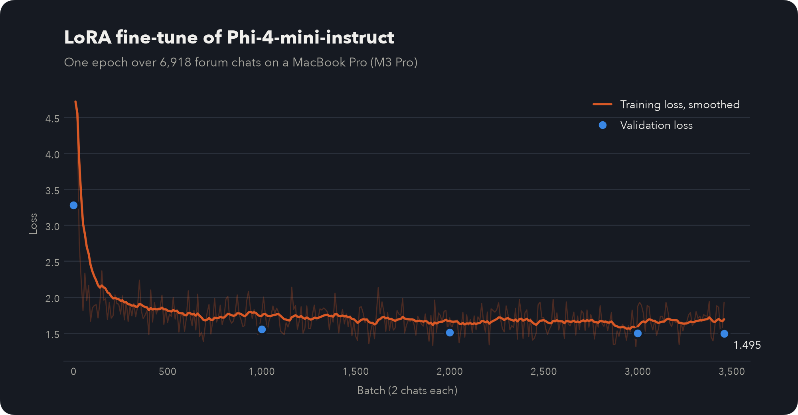

<p align="center">
  
</p>

<p align="center">
  <a href="https://huggingface.co/samadpls/torchlight-phi4-mini"></a>
  <a href="https://huggingface.co/datasets/samadpls/torchlight-threads"></a>
  <a href="https://samadpls.com"></a>
  <a href="LICENSE"></a>
  <a href="https://creativecommons.org/licenses/by/4.0/"></a>
  
</p>

<p align="center">
  <b>A PyTorch helper trained on the answers that solved real forum threads.</b><br>
  It gives a specific fix when a question has enough detail, and asks for the code or the error when it doesn't.
</p>

---

torchlight is a small model that helps with PyTorch questions. It learned from [PyTorch forum](https://discuss.pytorch.org) threads, each paired with the answer that solved it. The project has three parts:

| | Part | What it is | Where to get it |
|---|---|---|---|
| 1 | [Dataset](#1-dataset) | 7,354 forum questions with the answers that solved them | [`torchlight-threads`](https://huggingface.co/datasets/samadpls/torchlight-threads) |
| 2 | [Model](#2-model) | Phi-4-mini-instruct (3.8B), fine-tuned on a MacBook | [`torchlight-phi4-mini`](https://huggingface.co/samadpls/torchlight-phi4-mini), also as a [LoRA adapter](https://huggingface.co/samadpls/torchlight-phi4-mini-lora) and [GGUF](https://huggingface.co/samadpls/torchlight-phi4-mini-GGUF) |
| 3 | [Evaluation](#3-evaluation) | The model compared with its base model, with forum search, and with Claude Sonnet 5.5 | [Results below](#3-evaluation) |

⭐ If you find it useful, star the repo.

## Quickstart

```python
from transformers import pipeline

SYSTEM_PROMPT = (
    "You are a careful PyTorch helper. Give specific, correct guidance with code where it helps. "
    "If a question lacks the details needed to answer it, ask for them, for example a minimal "
    "executable code snippet or the full error message, instead of guessing."
)

chat = pipeline("text-generation", model="samadpls/torchlight-phi4-mini", dtype="auto", device_map="auto")
messages = [
    {"role": "system", "content": SYSTEM_PROMPT},
    {"role": "user", "content": "How do I check which device a tensor is on?"},
]
print(chat(messages, max_new_tokens=512)[0]["generated_text"][-1]["content"])
```

On a laptop, you can run the GGUF version with llama.cpp or Ollama:

```bash
llama-cli -hf samadpls/torchlight-phi4-mini-GGUF:Q4_K_M
ollama run hf.co/samadpls/torchlight-phi4-mini-GGUF:Q4_K_M
```

Use the system prompt above with any of them. The model was trained with it.

## 1. Dataset

[`samadpls/torchlight-threads`](https://huggingface.co/datasets/samadpls/torchlight-threads) comes from 22,484 forum threads. For each thread, it keeps the post marked as the solution, or the post the asker said fixed the problem. A small LLM agent reviewed the unclear cases.

| Split | Size | Threads from |
|---|---|---|
| Training | 6,925 chats | before July 2024 |
| Validation | 169 chats | July to December 2024 |
| Test | 260 questions | January 2025 to October 2026 |

The splits are by date, so the test questions are newer than anything the model trained on.

More: [how the data is collected and cleaned](src/torchlight/scrape/).

## 2. Model

| | |
|---|---|
| Base model | [Phi-4-mini-instruct](https://huggingface.co/microsoft/Phi-4-mini-instruct), 3.8B parameters |
| Method | LoRA, 11.5M trained parameters (0.30% of the model) |
| Training | 1 epoch with [mlx-lm](https://github.com/ml-explore/mlx-lm), 6.3 hours on a MacBook Pro (M3 Pro) |
| Validation loss | 3.280 before training, 1.495 after |
| Versions | Full model, LoRA adapter, GGUF (Q4_K_M and Q8_0) |

<p align="center">
  
</p>

More: [training settings, full loss table and how to run it](src/torchlight/train/).

## 3. Evaluation

Five setups answer the 260 test questions: Phi-4-mini and torchlight, each with and without forum search, and Claude Sonnet 5.5 with search as a reference. Claude Opus 5.5, acting as judge, scores each answer from 1 to 5 by comparing it with the answer that solved the thread. It sees the answers shuffled and without names.

The evaluation is still running. Results will be added here when it finishes.

More: [how the test works and how to rerun it](src/torchlight/eval/).

## 🚀 Reproduce

```bash
uv sync --all-extras

# 1. Dataset
uv run torchlight crawl              # about 2 hours
uv run torchlight build

# 2. Model
uv run torchlight train              # about 6.3 hours on a MacBook Pro (M3 Pro)
uv run torchlight fuse
uv run torchlight export

# 3. Evaluation
uv run torchlight index
uv run torchlight answer --arm A     # also B, D and E
uv run torchlight batches judge
uv run torchlight report
```

The dataset review runs as small LLM agents. In the evaluation, Claude Sonnet 5.5 and the judge (Claude Opus 5.5) run as Claude Code agents. No API key is needed. Each folder's README explains its steps.

<details>
<summary><b>Repo layout</b></summary>

```
src/torchlight/
├── scrape/      download forum threads
├── build/       clean threads, pick answers, build the dataset
├── train/       fine-tune with mlx-lm
├── retrieval/   forum search tool
├── eval/        answer and score the test questions
├── publish/     model cards, dataset card, export formats
└── cli.py
prompts/         instructions for the AI agents
notebooks/       training notebook for NVIDIA GPUs
assets/          logo, banner and charts
tests/
```
</details>

## Citation

```bibtex
@misc{samad2026torchlight,
  author = {Abdul Samad},
  title = {torchlight threads: resolved PyTorch forum questions and answers},
  year = {2026},
  url = {https://huggingface.co/datasets/samadpls/torchlight-threads}
}

@misc{samad2026torchlight_model,
  author = {Abdul Samad},
  title = {torchlight: a PyTorch helper fine-tuned on resolved forum threads},
  year = {2026},
  url = {https://huggingface.co/samadpls/torchlight-phi4-mini}
}
```

## Credits

Made by **Abdul Samad** · [samadpls.com](https://samadpls.com) · [GitHub @samadpls](https://github.com/samadpls) · abdulsamadsid1@gmail.com

The answers in the dataset were written by the PyTorch forum community, above all [ptrblck](https://discuss.pytorch.org/u/ptrblck). Every example links back to its thread.

## License

The code is under [Apache-2.0](LICENSE). The dataset is under [CC BY 4.0](https://creativecommons.org/licenses/by/4.0/), following the PyTorch forums' terms. The model is under MIT, like its base model. The logo is inspired by PyTorch's flame but is not the PyTorch logo. PyTorch is a trademark of the Linux Foundation.
