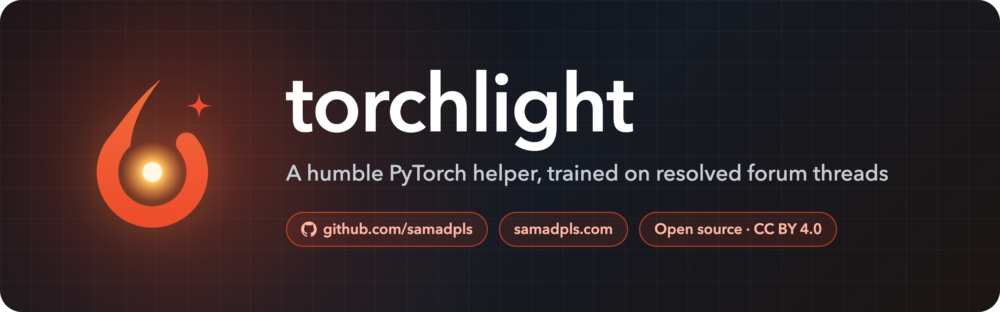
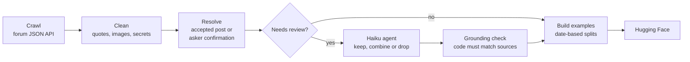

<p align="center">
  
</p>

<p align="center">
  <a href="https://huggingface.co/datasets/samadpls/torchlight-threads"></a>
  <a href="https://samadpls.com"></a>
  <a href="LICENSE"></a>
  <a href="https://creativecommons.org/licenses/by/4.0/"></a>
  
</p>

<p align="center">
  <b>A humble PyTorch helper, trained on resolved forum threads.</b><br>
  It gives a specific fix when the question has enough detail, and asks for a minimal repro when it doesn't.
</p>

---

torchlight learns from [PyTorch forum](https://discuss.pytorch.org) threads, each paired with the answer that actually resolved it. This repo holds the whole pipeline: crawling the forum, building the dataset, training the model, and measuring it against a general LLM that answers by calling a forum-search tool.

It's built in public, one piece at a time. ⭐ Star the repo to follow along.

## 🚦 Status

| | Part | Status |
|---|---|---|
| ✅ | Dataset: [`samadpls/torchlight-threads`](https://huggingface.co/datasets/samadpls/torchlight-threads) | Released (v0.1.0) |
| 🔜 | Evaluation harness and baselines | Next |
| 🗺️ | LoRA fine-tune on Apple Silicon (MLX) | Planned |
| 🗺️ | Fine-tuned model vs. tool-calling LLM | Planned |

## 📦 The dataset

[`samadpls/torchlight-threads`](https://huggingface.co/datasets/samadpls/torchlight-threads) on Hugging Face, CC BY 4.0:

| Config | Split | Rows | Contents |
|---|---|---|---|
| `sft` | train | 6,785 | Chat examples: 6,319 answers and 466 clarifying questions |
| `sft` | validation | 168 | Same format, threads from July to December 2024 |
| `eval` | test | 260 | Questions from 2025 onward with reviewed reference answers |
| `threads` | train | 22,484 | Every crawled thread, cleaned, with how it was resolved |

```python
from datasets import load_dataset

sft = load_dataset("samadpls/torchlight-threads", "sft")
evaluation = load_dataset("samadpls/torchlight-threads", "eval", split="test")
```

The threads come from those [ptrblck](https://discuss.pytorch.org/u/ptrblck), the forum's most active answerer, took part in, plus recent solved threads from everyone for evaluation. ptrblck is not treated as the source of truth. The answer is whichever post the forum marked as the solution, or the one the asker said fixed their problem.


## 🛠️ How it's built



1. **🕸️ Crawl** ([`src/torchlight/scrape/`](src/torchlight/scrape/)): fetch every thread through the forum's JSON API at 3 requests per second, caching each raw response in SQLite.
2. **🧭 Resolve** ([`build/resolve.py`](src/torchlight/build/resolve.py)): the answer is the accepted post, or the post the asker confirmed fixed it. A thank-you post marked as accepted points back to the post it thanks.
3. **🤖 Review** ([`prompts/review.md`](prompts/review.md)): answers that are only a question, very short, mostly a link, or that point at other posts go to an LLM agent. It keeps the post, drops the thread, or combines several posts into one answer. Every evaluation answer is reviewed too.
4. **🔒 Check**: a combined answer is rejected unless every code block in it appears verbatim in its source posts.
5. **📦 Build** ([`build/pipeline.py`](src/torchlight/build/pipeline.py)): multi-turn answer examples and clarification examples, split by date so evaluation threads are newer than anything trained on.

## 🚀 Reproduce it

```bash
uv sync --all-extras
uv run torchlight crawl      # about 2 hours at 3 requests/second
uv run torchlight build      # writes data/processed and review batches
```

<details>
<summary><b>How the review step runs</b></summary>

`torchlight build` writes the threads that need review to `data/review/batches/`. An agent (Claude Code or Codex CLI) reviews each batch by following [`prompts/review.md`](prompts/review.md) and writes its result to `data/review/results/`. Run `torchlight build` again to apply the results. Results are kept by thread id, so a rebuild only sends new threads for review.
</details>

<details>
<summary><b>Repo layout</b></summary>

```
src/torchlight/
├── scrape/      forum client, response cache, endpoints, crawl
├── build/       parsing, cleaning, answer selection, review, examples
├── publish/     dataset card
└── cli.py
prompts/         instructions for the review agents
assets/          logo and banners
tests/
```
</details>

## 🙌 Credits

Built by **Abdul Samad** · [samadpls.com](https://samadpls.com) · [GitHub @samadpls](https://github.com/samadpls) · abdulsamadsid1@gmail.com

The answers in the dataset were written by the PyTorch forum community, above all [ptrblck](https://discuss.pytorch.org/u/ptrblck). Every example links back to its source thread.

## 📜 License

The code is licensed under [Apache-2.0](LICENSE). The dataset is licensed under [CC BY 4.0](https://creativecommons.org/licenses/by/4.0/), following the PyTorch forums' terms. The logo is inspired by PyTorch's flame but is not the PyTorch logo; PyTorch is a trademark of the Linux Foundation.
