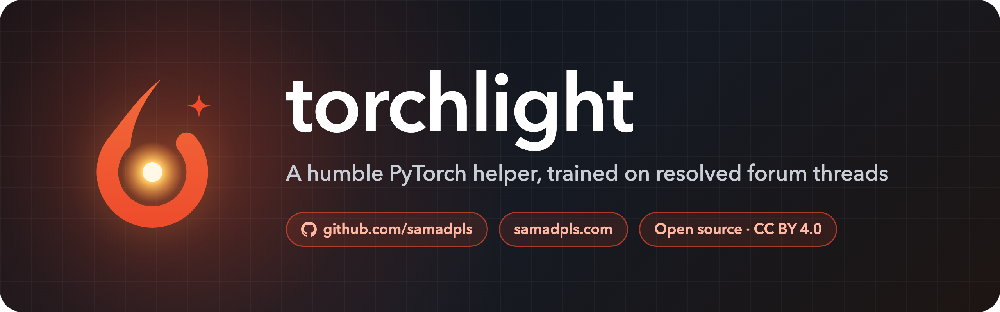
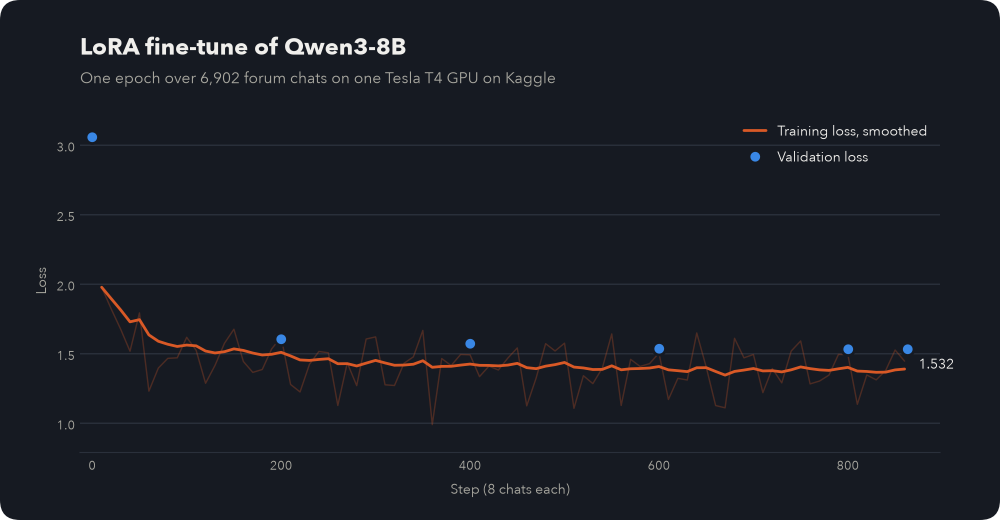
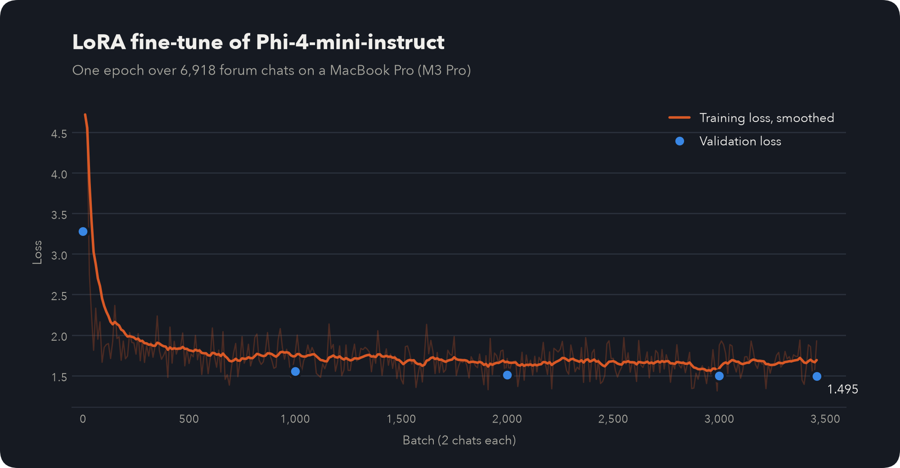

<p align="center">
  
</p>

<p align="center">
  <a href="https://huggingface.co/collections/samadpls/torchlight-6ae54bfcd2f87e2ae7078554"></a>
  <a href="https://huggingface.co/datasets/samadpls/torchlight-threads"></a>
  <a href="https://samadpls.com"></a>
  <a href="LICENSE"></a>
  <a href="https://creativecommons.org/licenses/by/4.0/"></a>
  
</p>

<p align="center">
  <b>A PyTorch helper trained on the answers that solved real forum threads.</b><br>
  Trained to give a specific fix when a question has enough detail, and to ask for the code or the error when it doesn't.
</p>

---

torchlight is a set of small models that help with PyTorch questions. They learned from [PyTorch forum](https://discuss.pytorch.org) threads, each paired with the answer that solved it. The project has three parts:

| | Part | What it is | Where to get it |
|---|---|---|---|
| 1 | [Dataset](#1-dataset) | 6,841 forum questions, each with the answer that solved it | [`torchlight-threads`](https://huggingface.co/datasets/samadpls/torchlight-threads) |
| 2 | [Models](#2-models) | Qwen3-8B fine-tuned on a free Kaggle GPU, and Phi-4-mini (3.8B) fine-tuned on a MacBook | [`torchlight-qwen3-8b`](https://huggingface.co/samadpls/torchlight-qwen3-8b) and [`torchlight-phi4-mini`](https://huggingface.co/samadpls/torchlight-phi4-mini), each also as a LoRA adapter and GGUF |
| 3 | [Evaluation](#3-evaluation) | The models compared with their base models on questions newer than their training data | [Results below](#3-evaluation) |

All releases are in the [torchlight collection](https://huggingface.co/collections/samadpls/torchlight-6ae54bfcd2f87e2ae7078554) on Hugging Face. ⭐ If you find it useful, star the repo.

## Quickstart

```python
from transformers import AutoModelForCausalLM, AutoTokenizer

SYSTEM_PROMPT = (
    "You are a careful PyTorch helper. Give specific, correct guidance with code where it helps. "
    "If a question lacks the details needed to answer it, ask for them, for example a minimal "
    "executable code snippet or the full error message, instead of guessing."
)

repo = "samadpls/torchlight-qwen3-8b"
tokenizer = AutoTokenizer.from_pretrained(repo)
model = AutoModelForCausalLM.from_pretrained(repo, dtype="auto", device_map="auto")
messages = [
    {"role": "system", "content": SYSTEM_PROMPT},
    {"role": "user", "content": "How do I check which device a tensor is on?"},
]
# The model was trained with thinking mode off.
text = tokenizer.apply_chat_template(
    messages, add_generation_prompt=True, tokenize=False, enable_thinking=False
)
inputs = tokenizer(text, return_tensors="pt").to(model.device)
output = model.generate(**inputs, max_new_tokens=512)
print(tokenizer.decode(output[0][inputs.input_ids.shape[1]:], skip_special_tokens=True))
```

On a laptop, you can run the GGUF version with llama.cpp or Ollama:

```bash
llama-cli -hf samadpls/torchlight-qwen3-8b-GGUF:Q4_K_M --reasoning off
ollama run hf.co/samadpls/torchlight-qwen3-8b-GGUF:Q4_K_M --think=false
```

Use the system prompt above with any of them. The models were trained with it. For a smaller download, use [`torchlight-phi4-mini`](https://huggingface.co/samadpls/torchlight-phi4-mini) (3.8B), which has no thinking mode to switch off.

## 1. Dataset

[`samadpls/torchlight-threads`](https://huggingface.co/datasets/samadpls/torchlight-threads) comes from 22,484 forum threads. For each thread, it keeps the post marked as the solution, or the post the asker said fixed the problem. A small LLM agent reviewed the unclear cases.

| Split | Size | Threads from |
|---|---|---|
| Training | 6,925 chats | before July 2024 |
| Validation | 169 chats | July to December 2024 |
| Test | 260 questions | January 2025 to October 2026 |

The splits are by date, so the test questions are newer than anything the models trained on.

More: [how the data is collected and cleaned](src/torchlight/scrape/).

## 2. Models

Both models were trained the same way: LoRA on the same chats, one epoch, with the loss on the final answer only.

| | [`torchlight-qwen3-8b`](https://huggingface.co/samadpls/torchlight-qwen3-8b) | [`torchlight-phi4-mini`](https://huggingface.co/samadpls/torchlight-phi4-mini) |
|---|---|---|
| Base model | [Qwen3-8B](https://huggingface.co/Qwen/Qwen3-8B), 8.2B parameters | [Phi-4-mini-instruct](https://huggingface.co/microsoft/Phi-4-mini-instruct), 3.8B parameters |
| Trained on | One free Tesla T4 GPU on Kaggle, with [Unsloth](https://github.com/unslothai/unsloth) | A MacBook Pro (M3 Pro), with [mlx-lm](https://github.com/ml-explore/mlx-lm) |
| Training time | 4.1 hours | 6.3 hours |
| LoRA | All layers, 4-bit base (QLoRA), 43.6M trained parameters | Top 16 of 32 layers, 16-bit base, 11.5M trained parameters |
| Validation loss | 3.059 before training, 1.532 after | 3.280 before training, 1.495 after |
| Versions | Full model, [LoRA adapter](https://huggingface.co/samadpls/torchlight-qwen3-8b-lora), [GGUF](https://huggingface.co/samadpls/torchlight-qwen3-8b-GGUF) | Full model, [LoRA adapter](https://huggingface.co/samadpls/torchlight-phi4-mini-lora), [GGUF](https://huggingface.co/samadpls/torchlight-phi4-mini-GGUF) |

The two models use different tokenizers, so their losses can't be compared with each other, only before and after training.

<p align="center">
  
</p>

<details>
<summary><b>Training loss of torchlight-phi4-mini</b></summary>

<p align="center">
  
</p>
</details>

More: [training on Kaggle](kaggle/) and [training on a Mac](src/torchlight/train/). The [training notebook](https://www.kaggle.com/code/samadpls/torchlight-qwen3-8b-train) is also public on Kaggle.

## 3. Evaluation

Claude Opus 5.5, acting as judge, scored each answer from 1 to 5 by comparing it with the answer that solved the thread. It saw the answers shuffled and without names. The test is hard on purpose: every question is newer than the models' knowledge.

### Qwen3-8B and Phi-4-mini, on the 163 newest questions

These questions are from April 2025 on, after Qwen3-8B's training data, which reportedly runs to March 2025. No model searched the forum here.

| Model | Average grade (out of 5) | Graded 4 or 5 | Wrong answers (graded 1) | Code with only real torch APIs | Asked for details, when they were missing | Asked for details, when not needed |
|---|---|---|---|---|---|---|
| Phi-4-mini (base model) | 1.96 | 5% | 33% | 108 of 109 | 0 of 4 | 1% |
| torchlight-phi4-mini (fine-tuned) | 2.09 | 8% | 16% | 5 of 5 | 0 of 4 | 5% |
| Qwen3-8B (base model) | 2.17 | 17% | 31% | 114 of 120 | 0 of 4 | 1% |
| torchlight-qwen3-8b (fine-tuned) | 2.25 | 9% | 15% | 11 of 11 | 3 of 4 | 13% |

**What the results show**

- **Half as many wrong answers.** Fine-tuning cut answers graded 1 (wrong) from 31% to 15% for Qwen3-8B, and from 33% to 16% for Phi-4-mini. Both gaps are real, not chance (p < 0.001).
- **The bigger model helps.** Qwen3-8B beats Phi-4-mini both before fine-tuning (2.17 against 1.96) and after (2.25 against 2.09). Both gaps are real (95% intervals +0.04 to +0.39 and +0.03 to +0.29).
- **It asks for missing details.** On the 4 questions where the expert first asked for more information, torchlight-qwen3-8b asked too on 3. None of the other models asked on any. It also asks when it doesn't need to on 13% of the other questions.
- **But it gives fewer complete fixes than Qwen3-8B itself.** 9% of its answers were graded 4 or 5, against 17% for the base model (p = 0.02). The base model writes long answers (a median of 1,024 tokens, often cut off) that more often contain the exact fix. The fine-tune learned the forum's short style (a median of 42 tokens).
- **On average, the fine-tune is a little ahead** of Qwen3-8B (2.25 against 2.17), but that gap is too small to be sure of (95% interval −0.09 to +0.23).
- **The test is hard by design.** These 163 questions are newer than Qwen3-8B's training data, and a 4 or 5 needs the same fix that solved the thread.

<details>
<summary><b>Phi-4-mini with and without forum search, on all 260 questions</b></summary>

The first comparison used all 260 test questions, which are newer than Phi-4-mini's knowledge (June 2024). Two of the setups could search the forum.

| Model | Average grade (out of 5) | Graded 4 or 5 | Wrong answers (graded 1) | Code with only real torch APIs | Asked for details, when they were missing | Asked for details, when not needed | Searches per question |
|---|---|---|---|---|---|---|---|
| Phi-4-mini (base model) | 1.88 | 5% | 39% | 170 of 175 | 0 of 7 | 0% | 0.0 |
| Phi-4-mini + forum search | 1.75 | 5% | 45% | 145 of 157 | 1 of 7 | 2% | 0.1 |
| torchlight-phi4-mini (fine-tuned) | 1.97 | 7% | 27% | 9 of 10 | 0 of 7 | 7% | 0.0 |
| torchlight-phi4-mini + forum search | 1.95 | 6% | 26% | 4 of 4 | 0 of 7 | 2% | 0.0 |

**What the results show**

- **Far fewer wrong answers.** 27% of torchlight-phi4-mini's answers were graded 1 (wrong), against 39% for the base model: 71 against 102. That gap is real, not chance (p = 0.003).
- **Better than giving the base model forum search.** torchlight-phi4-mini averages 1.97 against 1.75 (95% interval +0.09 to +0.35). Search pulled the small base model off topic: on the 23 questions where it searched, it averaged 1.35.
- **Short and fast.** The median answer is 31 tokens, against 690 for the base model, and it answered all 260 questions in 9 minutes, against 32.
- **The test is hard by design.** The questions are real forum posts from 2025 and 2026, after the model's knowledge ends, and a 4 or 5 needs the same fix that solved the thread. Every small setup gets a 4 or 5 on only 5–7% of questions. torchlight-phi4-mini raises the average grade from 1.88 to 1.97 and good answers from 14 to 19, but those gaps are too small to be sure of.
- **torchlight-phi4-mini never uses the search tool.** None of its training chats included tools, so adding search changes nothing.
- **A bigger model helps.** The same training on Qwen3-8B (8.2B parameters) scored higher on the newest questions. See [`torchlight-qwen3-8b`](https://huggingface.co/samadpls/torchlight-qwen3-8b).

</details>

More: [how the test works and how to rerun it](src/torchlight/eval/).

## 🚀 Reproduce

```bash
uv sync --all-extras

# 1. Dataset
uv run torchlight crawl              # about 2 hours
uv run torchlight build

# 2. Models
uv run torchlight train              # Phi-4-mini, about 6.3 hours on a MacBook Pro (M3 Pro)
uv run torchlight fuse
uv run torchlight export
uv run torchlight kaggle kernels push -p kaggle/train --no-run   # Qwen3-8B; start it on Kaggle

# 3. Evaluation
uv run torchlight index
uv run torchlight answer --arm A     # also B, D and E
uv run torchlight kaggle kernels push -p kaggle/answer --accelerator NvidiaTeslaT4
uv run torchlight batches judge --eval-set qwen --since 2025-04-01
uv run torchlight report --eval-set qwen --since 2025-04-01
```

The dataset review runs as small LLM agents, and the evaluation's judge (Claude Opus 5.5) as Claude Code agents. No API key is needed. Each folder's README explains its steps.

<details>
<summary><b>Repo layout</b></summary>

```
src/torchlight/
├── scrape/      download forum threads
├── build/       clean threads, pick answers, build the dataset
├── train/       fine-tune with mlx-lm on a Mac
├── retrieval/   forum search tool
├── eval/        answer and score the test questions
├── publish/     model cards, dataset card, export formats
└── cli.py
kaggle/          fine-tune and test Qwen3-8B on Kaggle's free GPUs
prompts/         instructions for the AI agents
notebooks/       training notebook for NVIDIA GPUs
assets/          logo, banner and charts
tests/
```
</details>

## Citation

```bibtex
@misc{samad2026torchlight,
  author = {Abdul Samad},
  title = {torchlight threads: resolved PyTorch forum questions and answers},
  year = {2026},
  url = {https://huggingface.co/datasets/samadpls/torchlight-threads}
}

@misc{samad2026torchlight_models,
  author = {Abdul Samad},
  title = {torchlight: PyTorch helpers fine-tuned on resolved forum threads},
  year = {2026},
  url = {https://huggingface.co/collections/samadpls/torchlight-6ae54bfcd2f87e2ae7078554}
}
```

## Credits

Made by **Abdul Samad** · [samadpls.com](https://samadpls.com) · [GitHub @samadpls](https://github.com/samadpls) · abdulsamadsid1@gmail.com

The answers in the dataset were written by the PyTorch forum community, above all [ptrblck](https://discuss.pytorch.org/u/ptrblck). Every example links back to its thread.

## License

The code is under [Apache-2.0](LICENSE). The dataset is under [CC BY 4.0](https://creativecommons.org/licenses/by/4.0/), following the PyTorch forums' terms. The models follow their base models' licenses: torchlight-qwen3-8b is under Apache-2.0 and torchlight-phi4-mini under MIT. The logo is inspired by PyTorch's flame but is not the PyTorch logo. PyTorch is a trademark of the Linux Foundation.
