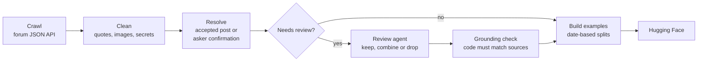
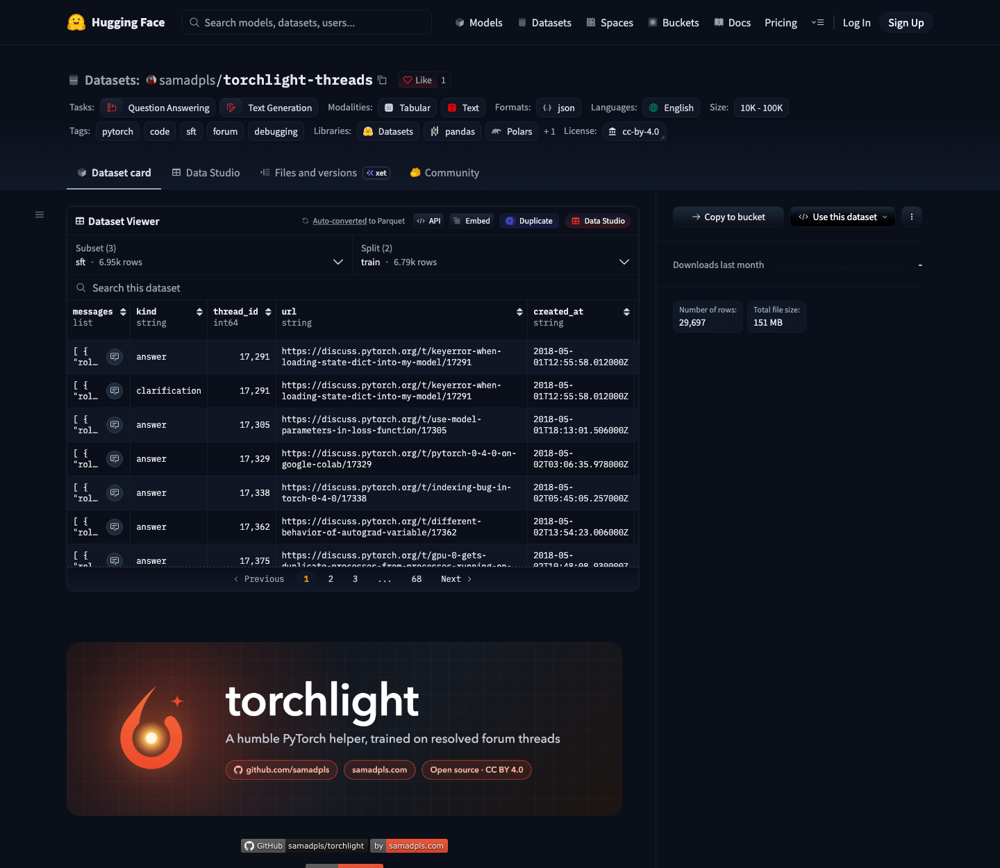

# Scraping the forums and building the dataset

This folder holds every piece of code that talks to [discuss.pytorch.org](https://discuss.pytorch.org). Everything after the crawl (cleaning, answer selection, review, export) runs offline from the cache it writes.

| File | What it does |
|---|---|
| `client.py` | Async HTTP client. A shared rate limiter (3 requests/second by default), retries with backoff on 429 and 5xx, `Retry-After` support, and a User-Agent that names the project and a contact address. |
| `cache.py` | SQLite cache of raw responses keyed by request path, zlib-compressed. A cached path is never requested again, so an interrupted crawl resumes where it stopped. |
| `endpoints.py` | The Discourse endpoints the crawl reads, and how threads longer than 20 posts are fetched in chunks. |
| `crawl.py` | The crawl itself: which topics to fetch and in what order. |

## Run it

```
uv run torchlight crawl --username ptrblck --eval-since 2025-01-01 --rate 3
```

Output goes to `data/raw/`:

- `forum.sqlite`: every raw response
- `topic_ids.json`: which topics came from which list

## What it fetches

1. `/u/{username}/summary.json` gives the user's post and solution counts, which size the next two steps.
2. `/user_actions.json?filter=15` lists the topics where the user's post is the accepted solution.
3. `/latest.json?order=created` pages back through the forum until `--eval-since` and keeps topics with an accepted answer from anyone. These become the evaluation set.
4. `/user_actions.json?filter=5` lists every topic the user replied in.
5. `/t/{id}.json?include_raw=1` fetches each topic with the raw Markdown of its posts. Threads with more than 20 posts get the rest from `/t/{id}/posts.json?post_ids[]=...&include_raw=1`.

Topics are fetched in that order (solved, recent, then the rest), so the most useful threads are cached first.

## Being polite

- The crawl stays under Discourse's default anonymous limit of about 3.3 requests per second, and backs off when the server asks it to.
- It never calls `/search`, which the forum's robots.txt disallows.
- Each request is made once; rebuilding the dataset never touches the forum.
- Forum content is licensed CC BY 4.0 under the LF Projects Terms of Use, so the dataset keeps a link to every source thread.

## From crawl to dataset

`uv run torchlight build` turns the cache into the dataset without touching the forum.



1. **Clean** ([`build/clean.py`](../build/clean.py)): remove quoted text, replace images with `[image]`, and redact emails and key-like strings. Code blocks stay exactly as written.
2. **Resolve** ([`build/resolve.py`](../build/resolve.py)): the answer is the accepted post, or the post the asker confirmed fixed it, whoever wrote it. A thank-you post marked as accepted points back to the post it thanks.
3. **Review** ([`prompts/review.md`](../../../prompts/review.md)): answers that are only a question, very short, mostly a link, or that point at other posts go to an LLM agent, along with every evaluation answer. The agent keeps the post, drops the thread, or combines several posts into one answer.
4. **Grounding check** ([`build/review.py`](../build/review.py)): a combined answer is rejected unless every code block in it appears verbatim in its source posts.
5. **Build** ([`build/pipeline.py`](../build/pipeline.py)): multi-turn answer examples and clarification examples, split by date so evaluation threads are newer than anything trained on.

<details>
<summary><b>How the review step runs</b></summary>

`torchlight build` writes the threads that need review to `data/review/batches/`. A small LLM agent reviews each batch by following [`prompts/review.md`](../../../prompts/review.md) and writes its result to `data/review/results/`. Run `torchlight build` again to apply the results. Results are kept by thread id, so a rebuild only sends new threads for review.
</details>

## The dataset this crawl produced

The crawl on 2026-10-29 made 24,756 requests in 128 minutes. Every one returned 200, with no rate-limit responses.

| | |
|---|---|
| Topics ptrblck posted in | 22,293 |
| Recent solved topics from other answerers | 193 |
| Topics in the dataset | 22,484 of the 22,486 fetched |
| Training examples (`sft`, train) | 6,925 (6,426 answers, 499 clarifications) |
| Validation examples (`sft`, validation) | 169 |
| Evaluation items (`eval`, test) | 260, every answer reviewed |
| Threads reviewed by an agent | 1,269 (408 kept, 449 combined, 412 dropped) |

Published as [samadpls/torchlight-threads](https://huggingface.co/datasets/samadpls/torchlight-threads).


